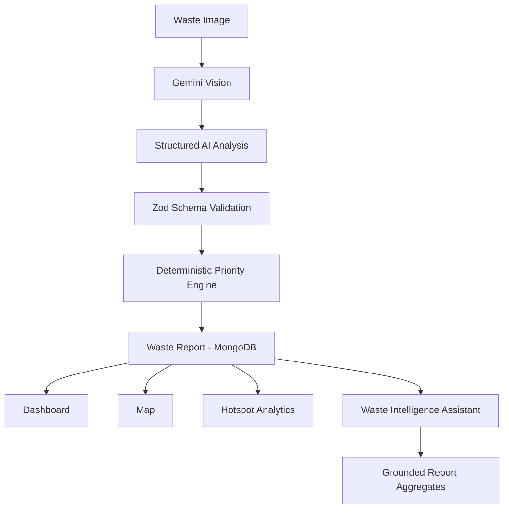

# SwachhAI

> **See waste. Understand it. Prioritize it. Act on it.**

SwachhAI is an **AI-first waste intelligence platform** that transforms unstructured waste
observations into explainable priority and actionable cleanup intelligence.

**Positioning:** SwachhAI is not "an AI garbage reporting app". It is a pipeline —
*Observe → Understand → Assess Risk → Prioritize → Act → Measure* — where AI provides
vision signals and deterministic code owns the final decision.

Built solo for the **AI First Product Builder Hackathon 2026** (Theme: *Solving India's
Garbage Problem — Technology for a Cleaner Bharat*, College division).

## Problem

Garbage problems in Indian cities are observed constantly but rarely converted into
structured, prioritized intelligence. Photos pile up in chats and complaint portals with no
ranking of risk, drainage impact, or urgency — so cleanup stays reactive and unmeasured.

## Solution

Upload a waste photo → Gemini vision returns structured signals → Zod validation →
deterministic priority engine (0–100, explainable) → persisted waste report → live
dashboard, hotspot map, and a grounded assistant. Every step ends in action:
prioritized cleanup, drain inspection, segregation guidance, status tracking.

## Why AI?

Manual triage doesn't scale: a photo alone carries no category, volume, or risk data.
Gemini vision converts each unstructured image into comparable signals (category,
severity, volume, drain / environmental / public-health risk). Without AI this product is
a photo album; with it, every observation becomes queryable civic data. Final priority
stays deterministic so decisions are consistent and auditable.

## Core Features

- **AI Waste Scanner** (`/analyze`): upload → staged progress UX → intelligence report
  (category, severity, risks, 0–100 priority, `Why this priority?` breakdown,
  recommended action, segregation guidance) → one-click report creation.
- **Reports** (`/reports`, `/reports/[id]`): status workflow
  `NEW → ASSESSED → ACTION_REQUIRED → IN_PROGRESS → RESOLVED`, per-report action center.
- **Dashboard** (`/dashboard`): KPIs, category/priority/status distributions, observed
  hotspots, recent table — all from live app data, demo entries labeled.
- **Map** (`/map`): Leaflet/OpenStreetMap with coarse public-area markers (no precise
  private addresses) + hotspot ranking.
- **Waste Intelligence Assistant** (`/assistant`): answers only from dataset aggregates;
  refuses with *"I don't have enough information…"* when unsupported.
- **Segregation guidance** on every result; **Action Center** checklists everywhere.

## Architecture



Monolith Next.js 16 App Router on Vercel. No microservices. Server routes own
validation; `lib/` owns business logic; UI is server-rendered with client islands
(analyzer, map, assistant, status updates).

## AI Pipeline

1. Client validates file (JPEG/PNG/WebP, ≤6MB) → `POST /api/analyze` (multipart).
2. `lib/gemini.ts` prompts Gemini (`gemini-2.0-flash`) for **strict JSON only**,
   extracts/recovers JSON, validates with `AIAnalysisSchema`. Malformed output →
   graceful `AI_INVALID`/`AI_UNAVAILABLE` errors, never stored as truth.
3. `calculatePriority()` (deterministic) produces the 0–100 score + band + breakdown.
4. Result screen shows hedged language (*appears to, potential, estimated*).
5. `POST /api/reports` re-validates and **recomputes priority server-side**.
6. Assistant queries precomputed aggregates only; fallback heuristics when keyless.

## Priority Model

> **SwachhAI prototype priority model** — decision support only, not an official
> municipal algorithm.

| Factor | Max pts |
|---|---|
| Severity | 25 |
| Environmental risk | 20 |
| Drain / infrastructure risk | 20 |
| Public-health risk | 15 |
| Visible accumulation (volume) | 12 |
| Public exposure | 8 |
| **Total** | **100** |

Bands: `0–24 LOW · 25–49 MODERATE · 50–74 HIGH · 75–100 CRITICAL`.
Each level maps LOW 15% / MODERATE 45% / HIGH 75% / CRITICAL 100% of its weight;
UI shows per-factor points + human-readable detail (`explainPriority`).

## Tech Stack

Next.js 16 (App Router) · React 19 · TypeScript (strict) · Tailwind v4 · Zod ·
Mongoose/MongoDB Atlas (indexed: `createdAt, status, priority, area`, in-memory
seeded fallback for demo resilience) · `@google/generative-ai` · Leaflet +
react-leaflet (OSM tiles) · Vitest.

## Data Sources

- **Real waste infrastructure — OpenStreetMap** (`data/waste-infrastructure.delhi.json`):
  Delhi's three major mapped disposal sites (Bhalswa / Ghazipur / Okhla landfills)
  with OSM way IDs and verified coordinates, fetched 2026-10-09 via Nominatim
  (Overpass was unreachable from the build environment; every candidate was
  individually verified — unmapped dhalaos/dustbins are honestly absent, not
  invented). License: **ODbL 1.0**, attribution "© OpenStreetMap contributors"
  shown on the map. Reproduce: `node scripts/fetch-osm-infrastructure.mjs`.
  Purpose: map infrastructure layer, nearest-facility guidance on reports,
  assistant grounding.
- **User-uploaded waste photos**: purpose — AI analysis; stored as small inline
  thumbnails; no personal data retained.
- **Synthetic demo dataset** (`lib/demo-data.ts`, ~24 reports, Delhi coarse areas):
  purpose — hackathon demo; all `isDemo: true` and labeled in UI. Not real reports.
- **OpenStreetMap tiles** (© OSM contributors): map rendering, standard tile usage.
- Public context (Swachh Bharat Mission / CPCB / data.gov.in) informed problem framing
  only; no datasets redistributed. (Kaggle was deliberately avoided: no credentials
  in this environment and unclear per-dataset licensing.)

## Demo

60–90s flow: `/` → **Analyze waste** → upload → AI analysis → priority + why →
**Create report** → dashboard/map/hotspots → ask assistant.
See `DEMO_SCRIPT.md` for the 3-minute judging script. Without API keys the app runs in
clearly-labeled demo mode (validated mock analysis + seeded memory store).

## Local Development

```bash
npm install
cp .env.example .env.local   # add GEMINI_API_KEY + MONGODB_URI
npm run dev                  # http://localhost:3000
```

## Environment Variables

| Var | Required | Purpose |
|---|---|---|
| `GEMINI_API_KEY` | for live AI | Gemini vision + assistant (absent → labeled mock fallback) |
| `MONGODB_URI` | for persistence | Atlas connection (absent → in-memory seeded store) |
| `GEMINI_MODEL` | no | default `gemini-2.0-flash` |
| `NEXT_PUBLIC_DEMO_MODE` | no | informational flag |

Never commit `.env*` (already gitignored).

## Security

- **Keys never reach the browser**: `GEMINI_API_KEY` / `MONGODB_URI` live only in
  `lib/env.ts`, guarded by the `server-only` package — any future client-side
  import is a *build error*, not a silent leak. Verified: no client component
  imports server modules; `npm run build` emits no secret strings.
- **Server logs are redacted**: `redactForLog()` scrubs connection strings and
  key-like tokens before any `console.error`.
- **Abuse resistance**: sliding-window rate limits — 10 vision calls/min,
  30 assistant calls/min, 30 report writes/min (429 + `Retry-After` beyond that).
- **Body caps**: 8MB analyze / 2MB report JSON / 16KB assistant & patches (413).
- **Upload validation**: JPEG/PNG/WebP only, ≤6MB; stored thumbnails are
  client-downscaled and must match a `data:image/…;base64` scheme (blocks
  `javascript:`/`blob:` smuggling into ``).
- **No injection surface**: Zod on every input (unknown keys stripped), enum-only
  status transitions, id length-capped, no `eval`/`dangerouslySetInnerHTML`
  anywhere, malformed DB documents are dropped (never half-shaped).
- **Headers**: `nosniff`, `DENY` framing, strict referrer, camera/mic/geo/payment
  disabled. No stack traces or framework internals reach users.
- **Dependencies**: production bundle has **0 known vulnerabilities**
  (`npm audit --omit=dev`); the 8 advisories are dev-only (vitest/eslint chains,
  never shipped) — noted, not churned.

## Testing

```bash
npm test          # vitest: priority bands, determinism, AI-schema validation, demo/hotspots
npx tsc --noEmit  # strict typecheck
npm run lint      # eslint
npm run build     # production build
```

API matrix covered manually: valid report · invalid image · missing fields · AI
failure (keyless) · DB failure (URI-less fallback). UI states: upload / loading stages /
success / error / empty.

## Privacy & Safety

No facial recognition, person identification, biometrics, surveillance, or precise
private-location collection. AI is instructed to analyze waste/environment only. Map
uses coarse/synthetic areas. Server validates everything; secrets stay server-side;
no stack traces reach users.

## AI Development Disclosure

- **Coding assistance**: AI agent for scaffolding/boilerplate; all architecture,
  priority weights, prompts, and copy reviewed and decided by the developer.
- **Models**: Gemini 2.0 Flash (vision analysis + grounded assistant).
- **Where AI assists at runtime**: image signal extraction, assistant answers from
  aggregates. **Where it does not**: final priority (deterministic code), validation
  (Zod), persistence, hotspot math.
- Malformed AI output is rejected, never stored as authoritative data.

## Limitations

- AI predictions are estimates; image quality affects accuracy.
- Priority scoring is a prototype decision-support model, not municipal doctrine.
- Demo reports are synthetic and labeled.
- Municipal integration is future work; local segregation rules vary.
- AI does not replace human inspection.

## Future Roadmap

- **Phase 2**: NGO/community queues, multilingual support, local rule packs, notifications.
- **Phase 3**: municipal API integration, route optimization, collection scheduling.
- **Phase 4**: IoT smart-bin / drain-sensor feeds, fixed-camera monitoring.

## Hackathon Alignment

AI-first (vision + grounded assistant at the core) · Innovation (observation→
intelligence pipeline, explainable priority) · Technical Execution (validated schema,
deterministic engine, tested, builds clean) · Feasibility (monolith, Atlas, Vercel,
proposed pilot workflow) · Impact (prioritized cleanup, hotspots, measurable statuses)
· Presentation (3-min demo script, coherent UI). Substantially built during the event
window; original work; AI usage disclosed above.

## License

MIT — see `LICENSE` (hackathon prototype; verify local rules before deployment).
